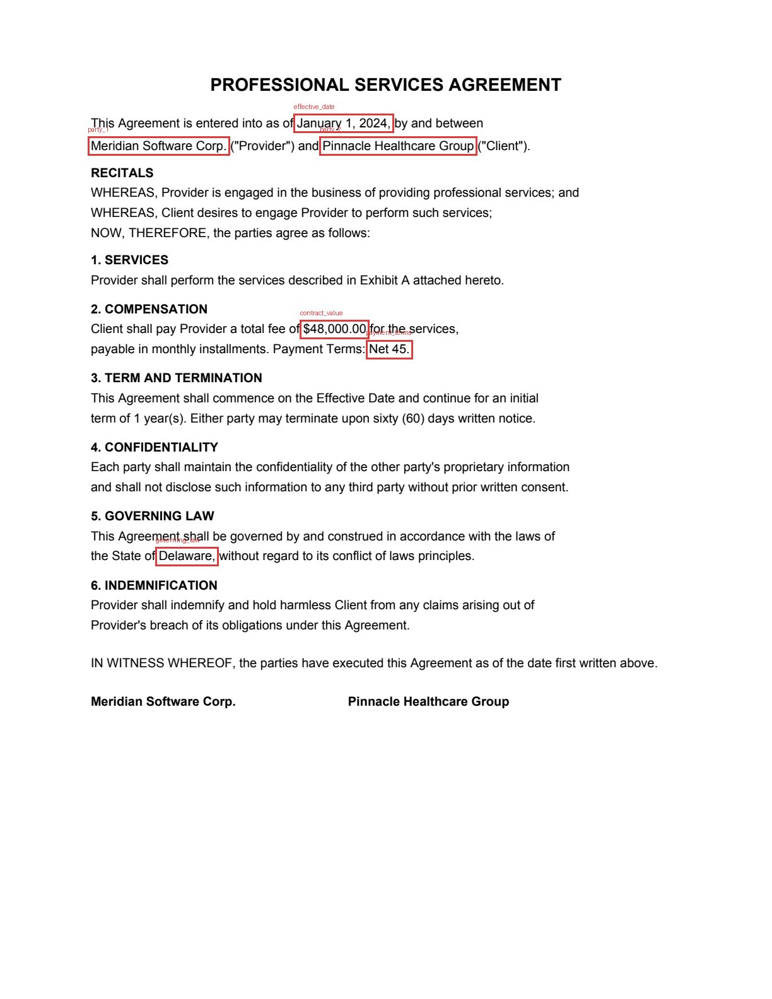
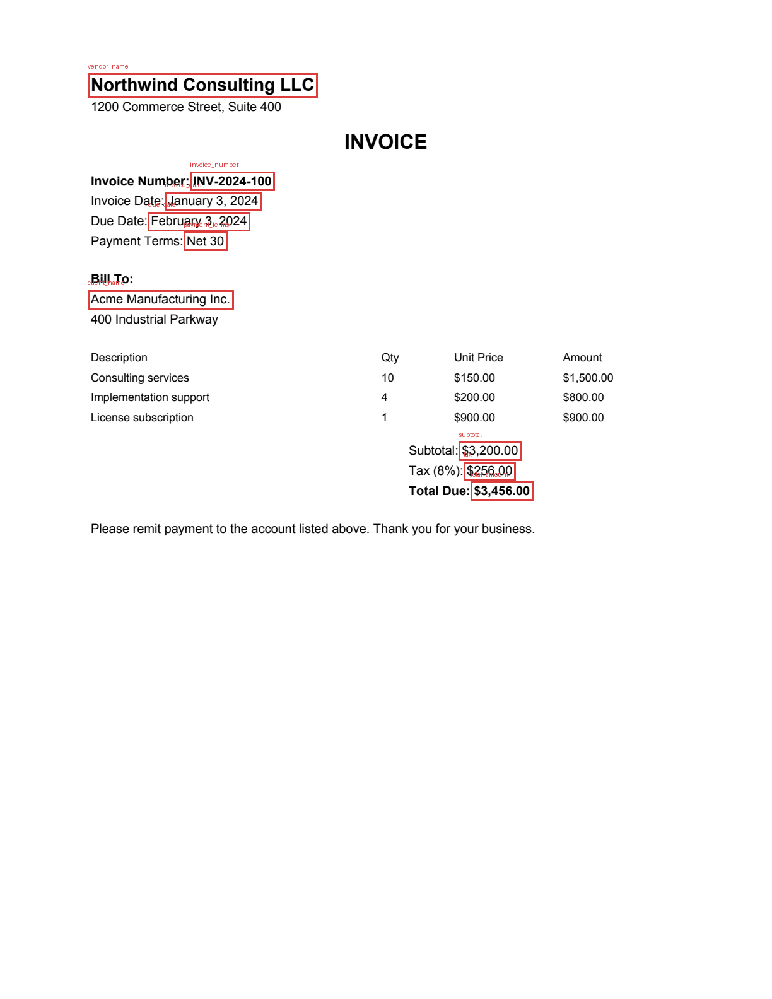

# Document Intelligence System

A full-stack, multi-modal Document AI application that extracts structured
information from complex legal and financial documents — contracts, invoices,
financial statements, court filings — from both native PDFs and scans.

**Hybrid extraction:** LayoutLMv3 (layout-aware entity extraction) + Donut
(OCR-free visual document QA) + a deterministic rules engine, with a
Tesseract + spaCy fallback — merged by source-weighted confidence voting so
every extracted field carries a calibrated confidence score, extractor
provenance, and a bounding box for visual verification.

<p align="center">
  
  
</p>

## Highlights

- **FastAPI backend** — async upload → background processing → results,
  semantic query, and dashboard APIs, all documented via OpenAPI (`/docs`)
- **Automatic document-type detection** — a supervised classifier (TF-IDF +
  Logistic Regression, trained on a 900-sample randomized synthetic corpus
  with an `other` negative class) ensembled with a keyword scorer and a
  zero-shot NLI fallback; agreement between independent tiers boosts
  confidence, and the deciding method is recorded per document
- **Field extraction with confidence scores** — parties, dates, amounts,
  clauses, payment terms, case numbers… schema per document type; every
  field records which extractor(s) produced it and where it sits on the page
- **Table extraction** — ruled tables via pdfplumber plus a custom
  word-geometry detector for borderless tables (the invoice/financial common
  case), emitted as structured JSON
- **Scanned + native support** — no-text-layer PDFs and images are routed
  through Tesseract automatically
- **Vector search + RAG** — ChromaDB with sentence-transformer embeddings and
  LangChain chunking; ask questions like *"What are the termination
  clauses?"* and get answers with page-level source citations. Optional LLM
  answer synthesis; extractive answering works with zero external services
- **Graceful degradation** — every heavy dependency is optional at runtime;
  `GET /health` reports exactly which extractors and vector backend are live
- **Streamlit frontend** — upload, extraction table with confidence badges,
  highlighted regions overlaid on the rendered page, semantic search, and a
  stats dashboard
- **Docker support** — lite and full-ML images, `docker compose up` for the
  whole stack

## Evaluation results

24 synthetic legal/financial documents (150 ground-truth fields; 6 each of
invoice, contract, financial statement, court filing), generated by
`evaluation/generate_dataset.py` and scored by `evaluation/run_eval.py`
with normalized exact/containment/numeric matching:

| Metric | Hybrid pipeline | Baseline (Tesseract/text + naive NER) |
|---|---|---|
| Field extraction accuracy | **100% (150/150)** | 49.3% (74/150) |
| Document-type detection | **100% (24/24)** | — |

**+50.7 percentage points over the baseline** — target was ≥ 90%. Per-type
breakdown and per-field diffs are written to `evaluation/results/report.md`
and `results.json`.

The supervised classifier is evaluated separately
(`evaluation/results/classifier_report.md`): **100% held-out accuracy** on a
stratified 20% split of the training corpus, and **24/24** on the PDF
evaluation set — which is generated from *different templates* than the
training data, so this is a genuine generalization check, not memorization.

Reproduce everything with:

```bash
python evaluation/generate_dataset.py     # 24 PDFs + ground truth
python training/train_classifier.py       # supervised classifier + report
python evaluation/run_eval.py             # hybrid vs baseline report
```

*(Numbers above are from the rules+layout path on native PDFs — the
deterministic floor of the system. The neural extractors add value on noisy
scans and unseen layouts, where regexes fail; add `--scanned` to generate
rasterized variants and exercise the OCR path.)*

## Quickstart

### Option A — lite (no GPU stack, ~30s install)

Runs the full API, rules+layout extraction, table extraction, TF-IDF
semantic search fallback, evaluation, and the frontend:

```bash
python3 -m venv .venv && source .venv/bin/activate
pip install -r requirements-lite.txt

uvicorn backend.app.main:app --reload          # API on :8000
streamlit run frontend/streamlit_app.py        # UI on :8501
```

### Option B — full ML pipeline

Adds LayoutLMv3, Donut, Tesseract+spaCy, ChromaDB + sentence-transformers:

```bash
pip install -r requirements.txt
python -m spacy download en_core_web_sm
brew install tesseract        # macOS (apt-get install tesseract-ocr on Debian)
```

Model checkpoints (`nielsr/layoutlmv3-finetuned-funsd`,
`naver-clova-ix/donut-base-finetuned-docvqa`) download automatically on
first use and are configurable via `.env` (see `.env.example`).

### Option C — Docker

```bash
docker compose up --build            # lite: API :8000 + UI :8501
FULL=1 docker compose up --build     # full ML stack
```

### Optional: LLM answer synthesis

Set `ANTHROPIC_API_KEY` in the environment to upgrade `/api/query` answers
from extractive to LLM-synthesized (grounded strictly in retrieved excerpts,
with citations). Without a key the extractive mode is used — no external
calls ever leave the machine.

## API

| Method | Path | Description |
|---|---|---|
| `POST` | `/api/documents/upload` | Upload PDF/image → `202` + id; processing runs async |
| `GET` | `/api/documents` | List documents with status |
| `GET` | `/api/documents/{id}` | Processing status / metadata |
| `GET` | `/api/documents/{id}/result` | Full extraction: type, fields (+confidence, source, bbox), tables |
| `GET` | `/api/documents/{id}/page/{n}` | Rendered page PNG (for overlays) |
| `DELETE` | `/api/documents/{id}` | Remove document + vector chunks |
| `POST` | `/api/query` | Semantic search / RAG question answering |
| `GET` | `/api/dashboard/stats` | Corpus statistics |
| `GET` | `/health` | Live extractor + vector-backend availability |

Example extraction result:

```json
{
  "document_type": "contract",
  "document_type_confidence": 0.98,
  "fields": {
    "party_1":        {"value": "Meridian Software Corp.", "confidence": 0.9,  "source": "rules", "page": 1, "bbox": [0.14, 0.20, 0.36, 0.21]},
    "effective_date": {"value": "January 1, 2024",         "confidence": 0.88, "source": "rules", "page": 1, "bbox": [0.38, 0.18, 0.51, 0.19]},
    "governing_law":  {"value": "Delaware",                "confidence": 0.9,  "source": "rules", "page": 1, "bbox": [0.21, 0.56, 0.29, 0.57]}
  },
  "tables": [{"page": 1, "rows": [["Description", "Qty", "Unit Price", "Amount"], ["Consulting services", "10", "$150.00", "$1,500.00"]]}],
  "meta": {"extractors_used": ["rules"], "is_scanned": false, "num_pages": 1, "processing_seconds": 0.05}
}
```

## How the hybrid pipeline works

```
PDF / image
   │
   ├─ 1. Ingest      pdfplumber text+word boxes · pypdfium2 rendering · Tesseract for scans
   ├─ 2. Classify    supervised TF-IDF+LogReg → keyword scorer → zero-shot NLI
   ├─ 3. Extract     LayoutLMv3 → Donut → Rules → Tesseract+spaCy (all optional except Rules)
   ├─ 4. Merge       confidence × source-weight vote; cross-extractor agreement boosts confidence
   └─ 5. Tables      ruled (pdfplumber) + borderless (word-geometry clustering)
   │
   ├──► SQLite       status + result JSON
   └──► ChromaDB     chunk embeddings for semantic search
```

Full details, including the merge math, coordinate normalization, and
degradation strategy: **[docs/ARCHITECTURE.md](docs/ARCHITECTURE.md)**.

## Project structure

```
backend/app/
  main.py                     FastAPI app + /health
  ml/doc_classifier.py        supervised classifier wrapper (lazy joblib load)
  config.py · database.py · schemas.py
  api/                        documents, query, dashboard routers
  workers/processor.py        background processing job
  pipeline/
    ingest.py                 PDF/image → pages (text + normalized word boxes)
    classifier.py             document-type detection
    hybrid.py                 orchestration + confidence merge
    tables.py                 ruled + borderless table extraction
    extractors/               layoutlm.py · donut.py · rules.py · ocr_fallback.py
  rag/
    store.py                  ChromaDB (TF-IDF fallback) + chunking
    qa.py                     extractive / LLM answer synthesis
frontend/streamlit_app.py     upload · results+overlay · ask · dashboard
training/train_classifier.py  corpus generator + TF-IDF/LogReg training
models/                       doc_classifier.joblib + metrics (retrainable)
evaluation/
  generate_dataset.py         24-doc synthetic test set + ground truth
  run_eval.py                 hybrid vs baseline accuracy report
  results/                    report.md · results.json · classifier_report.md
tests/                        pipeline unit tests + API integration tests
scripts/make_screenshots.py   regenerate the demo overlays
```

## Tests

```bash
pytest tests/ -q     # 22 tests: pipeline units, ML classifier + full API integration flow
```

## Design decisions

- **Why hybrid instead of a single model?** Legal/financial extraction needs
  *calibrated trust*. Deterministic rules are precise on known layouts but
  brittle; vision transformers generalize to unseen layouts and scans but
  can hallucinate. Voting between them — and boosting confidence when
  independent methods agree — yields both coverage and an honest confidence
  signal per field.
- **Why TF-IDF + Logistic Regression for classification (not a transformer)?**
  Document classes here are separable by vocabulary; a linear model over
  n-grams gives calibrated probabilities, millisecond inference, a 432 KB
  artifact, and inspectable coefficients (you can print exactly which terms
  drove a prediction — valuable in legal settings). The ensemble design means
  a LayoutLMv3 sequence-classification head fine-tuned on RVL-CDIP can drop
  in as a stronger tier later without touching callers.
- **Why normalized bounding boxes everywhere?** One coordinate system feeds
  LayoutLMv3 (0–1000 space), the merge step, and the frontend overlay at any
  render scale, and makes OCR and native-PDF words interchangeable.
- **Why optional dependencies?** A 6 GB torch stack shouldn't be the price of
  admission for running the API or the evaluation. Every extractor
  self-reports availability; behavior is inspectable via `/health`.

## Limitations / roadmap

- The evaluation set is synthetic; real-world scans (skew, stamps,
  handwriting) will reduce accuracy — the confidence scores are designed to
  surface exactly that.
- FUNSD/DocVQA checkpoints are generic; fine-tuning LayoutLMv3 on CUAD
  (contracts) or SROIE (receipts) is the highest-value next step.
- Background processing is in-process; swap `BackgroundTasks` for Celery/RQ
  for multi-worker deployments (single-line change in `api/documents.py`).
- Clause-level extraction (termination, indemnification, confidentiality as
  spans) is currently handled by the RAG query path rather than the field
  schema.

## License

MIT
